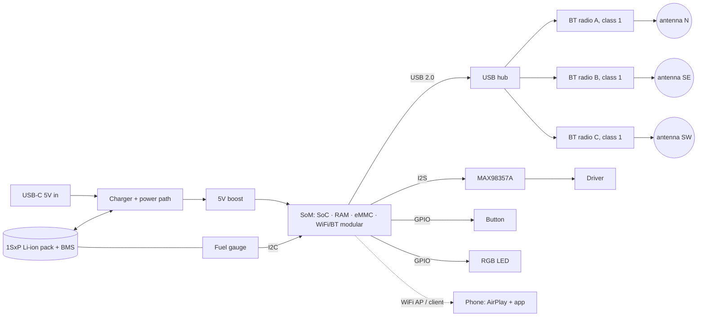

# Campfire Bridge Speaker — Product Roadmap & Launch Plan

> Living document. Update as work progresses. Check boxes as tasks complete.
>
> Status: `[ ]` not started · `[~]` in progress · `[x]` complete

---

## Product Overview

A self-contained wireless speaker product with an embedded Linux board, multiple Bluetooth USB dongles, and an amplifier/DAC built into one enclosure. The device receives audio streamed from a phone via AirPlay (iOS) or Cast (Android) and outputs simultaneously to its built-in speaker and up to 1 or 3 paired external Bluetooth speakers. No cloud account required for playback — the device works on a local network or its own hotspot. Controlled through the Campfire app.

---

## Product SKUs

| SKU | External BT USB Dongles | Total Output Channels |
|---|---|---|
| **STANDARD** (was Limited) | 1 | Built-in speaker + 1 external BT speaker — selling first |
| **EXTENDED** | 3 | Built-in speaker + 3 external BT speakers — selling first |
| **LITE** | 0 | Built-in speaker only (Flip-class acoustic design) — later |

The Pi's built-in Bluetooth adapter is **disabled and unused**. All speaker outputs run through the external USB dongles exclusively.

---

## Audio Architecture

**Removed:** librespot (Spotify Connect) — no longer needed, eliminates Spotify ToS risk  
**Kept:** shairport-sync (AirPlay 2) — iOS audio streaming  
**Added:** Cast receiver — Android audio streaming

**How sound segregation works:**
- Once the phone starts an AirPlay or Cast session, audio is sent to the device and plays there independently
- Phone audio (calls, system sounds, notifications) stays on the phone speaker
- Making a call, scrolling Instagram, switching apps — none of it pauses the music on the device
- Any app that supports AirPlay (iOS) or Cast (Android) works: Apple Music, Spotify, YouTube Music, Tidal, etc.
- Removes dependency on any single music service

**App role shift:** Because AirPlay and Cast handle their own playback transport, the Campfire app becomes a **setup and device management app**, not a playback remote. Playback is controlled through iOS Control Center (AirPlay picker) and Android Cast controls in music apps. The Bridge API playback routes (play/pause/next/etc.) can be removed.

---

## Connectivity Modes

The device switches between three modes automatically:

| Mode | When | How App Connects | Internet Required |
|---|---|---|---|
| **Home** | Device joined to home WiFi, phone on same network | Direct LAN via mDNS | No |
| **Remote** | Device on home WiFi, phone elsewhere | Cloud WebSocket relay | Yes (both sides) |
| **Camping / Offline** | No known WiFi in range, or manually forced | Device creates a `Campfire-XXXX` hotspot; phone joins it; direct LAN | No |

Camping mode is a **launch requirement**, not a v2 feature. This is core to the product identity.

In camping mode:
- Device broadcasts a WiFi hotspot automatically when no known network is found
- Phone joins the hotspot — iOS will still route cellular data normally; Android prompts to confirm
- App discovers device via mDNS on the hotspot network
- AirPlay works over this local connection without internet

---

## Ownership & Access Model

Multiple scenarios are supported from day one:

### Scenarios

| Scenario | How It Works |
|---|---|
| **Normal use** | Owner controls their device from their account |
| **Friend takes over (no ownership change)** | Owner generates a time-limited Controller link/code in the app. Friend redeems it in their Campfire app. They can control playback and BT speakers but cannot rename, transfer, or change settings. Expires after a set duration (default 24h) or when owner revokes. |
| **Phone dies, friend takes over** | Same as above — owner generates controller code before phone dies, or another authorized controller is already set up |
| **Sell/transfer used device** | Owner initiates Transfer in app → generates a one-time transfer token (24h expiry). New owner enters token in their Campfire app. Backend: changes `owner_id`, deletes all existing access records, sends factory-reset signal to device to clear stored WiFi credentials and auth. |
| **Gift a device** | Owner generates a gift code (device doesn't need to be present). Recipient redeems in their app at any time. Same backend effect as transfer. |
| **One account, multiple devices** | All devices appear in a list. Owner can switch active device, rename, manage access per device. |

### Access Roles

| Role | Can do |
|---|---|
| **Owner** | Everything: play, manage BT speakers, rename, grant/revoke access, transfer, delete |
| **Controller** | Play/pause, manage BT speakers; cannot change settings or transfer ownership |

---

## Standard Operating Procedure (Dev Sessions)

### Deploying bridge changes to the Pi

**Terminal 3 — rsync from Mac to Pi**
```bash
rsync -avz --exclude 'node_modules' --exclude 'dist' \
  /Users/icestation/Projects/campfire-bridge/bridge/ \
  pi@campfire-bridge.local:/home/pi/campfire-bridge/bridge/
```

**Terminal 2 — remote build (one-off, no interactive session needed)**
```bash
ssh pi@campfire-bridge.local "cd ~/campfire-bridge/bridge/api && npm install && npm run build"
```

**Terminal 4 — already SSH'd in: restart bridge API**
```bash
systemctl --user restart campfire-bridge
```

> Git push to GitHub is separate from Pi deployment. rsync pushes code directly; git is for version history. Push to GitHub once a task is confirmed working on the Pi.

---

## Current State (What Exists)

| Component | Status | Notes |
|---|---|---|
| shairport-sync (AirPlay 2) | ✅ Done | Runs as user service; starts/stops with party mode |
| PulseAudio + BT stack | ✅ Done | multi-adapter, A2DP auto-recovery on restart |
| Bluetooth scripts (bt_connect, bt_pair, etc.) | ✅ Done | Keep |
| Bridge API (Express/TS) | ✅ Done | BlueZ via D-Bus snapshot (`bluez.ts`), incremental party graph (`party.ts`), crash-proof routes; same HTTP contract. Refactored 2026-10-07, verified on the Pi and committed 2026-10-12. |
| librespot | ✅ Removed | Deleted — no longer in codebase |
| SpotifyContext / spotifyAuth | ✅ Removed | Deleted from app |
| React Native app (iOS) | 🔶 Functional | Spotify removed; Home/Camping mode toggle; default Home URL = `http://campfire-bridge.local:3000`; Tailscale removed; auto URL fallback (3-failure → switch mode); migration for old AsyncStorage keys; needs account, setup wizard, device mgmt, ownership |
| Mock bridge server | ✅ Done | Updated to match current API shape |
| mDNS / avahi | ✅ Done | Advertises AirPlay; needs device serial in TXT record |
| camping-mode daemon | 🔶 Partial | `camping-mode.sh` + NM hotspot profile done; auto-switches home↔camping; home→camping needs 4 consecutive misses (2 min) so WiFi blips no longer kill AirPlay; never scans or switches while a phone is on the hotspot; WiFi power save disabled; `POST /api/network/mode` endpoint done; SSID is "Campfire" (not serial-suffixed yet — needs #10); LED/button not done |
| App auto URL detection | ✅ Done | After 3 failures on primary URL, tries fallback; auto-switches mode on success |

---

## Phase 1 — Software Foundation

### 1.1 Bridge Firmware / Device Software

#### Remove librespot
- [ ] Remove librespot systemd service
- [ ] Remove `bridge/config/librespot.env`
- [ ] Remove `bridge/systemd/librespot.service`
- [ ] Remove librespot-related Bridge API routes

#### WiFi Provisioning — BLE Flow (first-boot)
- [ ] Device advertises a `CampfireBridge` BLE service UUID when unconfigured
- [ ] BLE characteristic accepts encrypted SSID + password payload from app
- [ ] On receipt, write WiFi credentials and reboot into home mode
- [ ] Fallback: if BLE provisioning fails, device creates a hotspot; app connects and POSTs credentials via HTTP

#### Camping / Offline Mode
- [ ] `camping-mode.service` — systemd service that monitors for known WiFi networks
- [ ] If no known network found after 60 seconds of boot: switch to AP (hotspot) mode
- [ ] Hotspot SSID: `Campfire-<last4ofserial>`
- [ ] Hotspot password: ships as a known default (`campfire123` or similar); **the app forces the user to set a new one on first connect** and the device refuses to leave setup until they do *(decided 2026-10-13 — supersedes "password printed on device label"; see Known Issue #5)*
- [ ] Physical button: short press toggles camping mode manually
- [ ] LED states: pulsing blue = unconfigured, solid white = home/connected, orange = camping/hotspot, red = error

#### Multi-Dongle Audio Management
- [ ] PulseAudio config: enumerate each USB BT dongle as a separate named sink
- [ ] `GET /api/dongles` — returns list of dongle slots (1 for Limited, 4 for Extended) with paired device info
- [ ] Dongle slot ↔ paired BT speaker mapping persisted to disk
- [ ] On boot, auto-reconnect each dongle to its previously paired speaker

#### Completed Bridge API Routes (device management focus)
- [ ] `GET /api/status` — network mode, dongle slot states, firmware version, uptime
- [ ] `GET /api/bt/devices` — scan for nearby BT speakers
- [ ] `POST /api/bt/pair` `{ slot, mac }` — pair a speaker to a specific dongle slot
- [ ] `POST /api/bt/connect` `{ slot }` — connect slot to its paired speaker
- [ ] `POST /api/bt/disconnect` `{ slot }` — disconnect slot
- [ ] `GET /api/bt/slots` — current state of all dongle slots
- [ ] `POST /api/network/mode` `{ mode: 'home' | 'camping' }` — force mode switch
- [ ] `GET /api/update/status` — current firmware version, available version

#### Device Identity (manufacture-time)
- [ ] Serial number format: `CB-<SKU>-<6-char-alphanum>` (e.g. `CB-EXT-A3F7K2`)
- [ ] At flash time: burn serial + device certificate/key to `/etc/campfire/identity`
- [ ] Device uses cert to authenticate all requests to the cloud backend
- [ ] mDNS advertisement includes device serial in TXT record

#### OTA Update Agent
- [ ] Evaluate: Mender.io (recommended for embedded Linux) vs Balena vs custom poll
- [ ] Device polls `GET /firmware/latest` on startup and every 4 hours
- [ ] Staged rollout: backend can target updates to a serial range or SKU

---

### 1.2 Backend (New — all of this)

**Stack:** Node.js/TypeScript + PostgreSQL  
**Hosting:** Railway or Fly.io (start simple, scale later)

#### Database Schema

```sql
users (
  id UUID PRIMARY KEY,
  email TEXT UNIQUE NOT NULL,
  password_hash TEXT NOT NULL,
  created_at TIMESTAMPTZ DEFAULT now()
)

devices (
  id UUID PRIMARY KEY,
  serial TEXT UNIQUE NOT NULL,
  sku TEXT NOT NULL,                  -- 'limited' | 'extended'
  owner_id UUID REFERENCES users(id),
  name TEXT,
  firmware_version TEXT,
  last_seen TIMESTAMPTZ,
  cert_fingerprint TEXT,
  network_mode TEXT                   -- 'home' | 'camping' | 'offline'
)

device_access (
  id UUID PRIMARY KEY,
  device_id UUID REFERENCES devices(id),
  user_id UUID REFERENCES users(id),
  role TEXT NOT NULL,                 -- 'owner' | 'controller'
  expires_at TIMESTAMPTZ,            -- NULL = permanent (owner), timestamp = temp controller
  created_by UUID REFERENCES users(id)
)

transfer_tokens (
  id UUID PRIMARY KEY,
  device_id UUID REFERENCES devices(id),
  token TEXT UNIQUE NOT NULL,
  created_at TIMESTAMPTZ DEFAULT now(),
  expires_at TIMESTAMPTZ NOT NULL,   -- 24h from creation
  used_at TIMESTAMPTZ
)

gift_codes (
  id UUID PRIMARY KEY,
  device_id UUID REFERENCES devices(id),
  code TEXT UNIQUE NOT NULL,
  created_by UUID REFERENCES users(id),
  redeemed_by UUID REFERENCES users(id),
  redeemed_at TIMESTAMPTZ
)

firmware_releases (
  id UUID PRIMARY KEY,
  version TEXT NOT NULL,
  sku TEXT,                           -- NULL = all SKUs, or 'limited'/'extended'
  url TEXT NOT NULL,
  sha256 TEXT NOT NULL,
  released_at TIMESTAMPTZ DEFAULT now(),
  rollout_pct INT DEFAULT 100        -- staged rollout percentage
)
```

#### Auth Service
- [ ] `POST /auth/register`
- [ ] `POST /auth/login` → JWT
- [ ] `POST /auth/forgot-password` → email with reset link
- [ ] `POST /auth/reset-password`

#### Device Registry
- [ ] `POST /devices/claim` — submit serial from box; backend verifies real unowned device; assigns to account
- [ ] `GET /devices` — list all devices user owns or has controller access to
- [ ] `PATCH /devices/:id` — rename
- [ ] `DELETE /devices/:id` — remove (triggers factory-reset signal to device)

#### Ownership & Access Endpoints
- [ ] `POST /devices/:id/transfer/initiate` — owner generates one-time transfer token (24h expiry)
- [ ] `POST /devices/transfer/redeem` — new owner submits token; backend changes `owner_id`, deletes all `device_access` rows, pushes factory-reset command to device
- [ ] `POST /devices/:id/gift` — generate gift code; device assigned to code, not yet claimed
- [ ] `POST /devices/gift/redeem` — recipient redeems gift code; same effect as transfer
- [ ] `POST /devices/:id/access/grant` — owner grants temporary controller access (by email, or returns shareable token link)
- [ ] `GET /devices/:id/access` — list current access grants
- [ ] `DELETE /devices/:id/access/:userId` — revoke controller access

#### Cloud WebSocket Relay
- [ ] Device maintains persistent WebSocket connection to backend after boot
- [ ] App connects to relay when it cannot reach device directly on LAN
- [ ] App always tries direct LAN (mDNS) first; relay is automatic fallback
- [ ] Relay routes: device commands (BT connect/disconnect, network mode) and status updates
- [ ] Audio stream never passes through the cloud — AirPlay/Cast operate peer-to-peer on the local network
- [ ] Relay is inactive in camping mode (no internet); app connects directly to device's hotspot

#### OTA Server
- [ ] `GET /firmware/latest?sku=extended&current=1.2.3` → `{ version, url, sha256 }` or `{ upToDate: true }`
- [ ] Firmware images stored in Cloudflare R2 or S3

---

### 1.3 Mobile App Changes

#### Remove Spotify-specific code
- [ ] Remove `SpotifyContext.tsx`
- [ ] Remove `SpotifyLoginScreen.tsx`
- [ ] Remove `spotifyAuth.ts`
- [ ] Remove `spotifyClientId` from `SettingsContext.tsx`
- [ ] Remove Music tab's Spotify-specific UI; Music tab becomes AirPlay/Cast instructions or is removed

#### New: Account Screens
- [ ] Sign up (email + password)
- [ ] Log in
- [ ] Forgot / reset password

#### New: Device Setup Wizard (first-run flow)
1. "Power on your Campfire Bridge Speaker — LED pulses blue"
2. App scans BLE for `CampfireBridge` service UUID
3. App connects, sends WiFi SSID + password over encrypted BLE characteristic
4. Device reboots onto home WiFi, LED turns solid white
5. "Enter the serial number from the bottom of your speaker" → `POST /devices/claim`
6. App discovers device on LAN via mDNS, confirms connection
7. "You're set up. Use AirPlay (iOS) or Cast (Android) to start playing music."

#### New: Multi-Device & Ownership Screens
- [ ] Device list (owned + controller access — visually differentiated)
- [ ] Switch active device
- [ ] Rename device
- [ ] Per-device access list (owner view): who has controller access, expiry
- [ ] Grant controller access → generates shareable link/code
- [ ] Revoke controller access
- [ ] Transfer ownership flow (initiate + confirm)
- [ ] Gift device flow
- [ ] Accept transfer / redeem gift flow

#### Settings Screen Updates
- [ ] Remove bridge URL manual entry (replaced by account + device registry)
- [ ] Remove Spotify client ID field
- [ ] Show: current network mode (Home / Remote / Camping)
- [ ] Button: force Camping Mode

#### Android Support
- [ ] BLE provisioning (react-native-ble-manager already installed — needs provisioning flow wired up)
- [ ] Cast SDK integration (Google Cast for React Native)
- [ ] Test BLE provisioning on Android
- [ ] Test Cast session from common Android music apps
- [ ] ⚠️ Known limitation: Cast SDK requires internet for initial session handshake. Android users in camping/offline mode cannot use Cast. Workaround: document limitation; evaluate UPnP/DLNA as offline fallback for Android.

#### App Distribution
- [ ] Apple Developer Program ($99/yr) — submit via App Store Connect
- [ ] Google Play Console ($25 one-time) — submit via Play Console
- [ ] Privacy policy URL (required by both stores)
- [ ] App screenshots for both stores

---

## Phase 2 — Hardware Finalization (run in parallel, 8–16 weeks)

### Lightest Certifiable Campfire (decided 2026-10-21 — supersedes the sections below where they differ)

Branches: **`pi5-dev-rig`** = the working Pi 5 baseline, frozen.
**`lightest-certifiable-campfire`** = all new code and steps.
Manual: `docs/first-speaker-manual.md`. Design: `hardware/README.md`.
Shopping list: `hardware/bom/phase1-shopping-list.md`.

| Decision | Choice |
|---|---|
| Phone link | AirPlay 2 stays (sound segregation). Bluetooth-in "sync-only" product tabled. |
| Phase 1 compute | **Raspberry Pi 4 Model B 1 GB** — 5 GHz, FCC Single Modular grant 2ABCB-RPI4B, same image, no port, 4 USB ports |
| Phase 2 compute | CM4 Lite 1 GB wireless on our carrier (2ABCB-RPICM4), eMMC option |
| Radios | Certified modules only: Ezurio BT851 (plug-in) → BT850-ST / Fn-Link 6221E-UUC (soldered). H618/RK3566 boards rejected: no modular grant |
| Built-in | STANDARD/EXTENDED: Go class (MAX98357A + 2-inch driver + passive radiator + software EQ). LITE: Flip class (TAS5805M, 2-way, 3S) later |
| Battery | 2 × 18650 on a UPS board with I²C gauge → safe shutdown; third cell optional |
| Backend | none — button = credential, long press = factory reset, firmware from a static file host. Work items #5–#8, #11 (BLE), #13 (BLE wizard), #15, #19–#22 are **superseded** unless Remote mode returns |
| Certification | Part 15B + SDoC only (~$4–10k), co-location evaluation, "Contains FCC ID" labels, Bluetooth SIG declaration (~$2.5k), UN38.3 cells. **A hand-built Phase 1 unit is certifiable and sellable**; the carrier is a cost-down |

Parts, you assemble: STANDARD $84–95 / EXTENDED $96–129 (one-off with the UPS
HAT: $175 / $220). Carrier @100: $98–105 / $110–131.

Software milestones on the branch (S1–S8, each tested on the Pi 5 first):
trim · AirPlay 2 from source + nqptp · read-only root · boot auto-start ·
hotspot provisioning + forced password + per-unit SSID · prefer 5 GHz ·
USB 2.0 port preference · built-in DSP chain.


### Hardware Characterization (must precede BOM finalization)

The Pi 5 dev rig is known-good but over-specified. Before committing to a BOM,
measure what the workload actually needs. Harness lives in `bridge/diagnostics/`
(see its `README.md` for the method and `EXPERIMENTS.md` for the per-component tests).

Key constraint driving the whole exercise: **the audio path is single-threaded**.
PulseAudio's null-sink → N × loopback → N × SBC encode chain runs in one thread,
so the SoC is chosen on single-thread performance, not core count. A cheaper board
with more, slower cores is worse, not better.

- [ ] Baseline capture on Pi 5 — Extended SKU worst case (3 BT + wired), camping mode, idle
- [ ] Constraint sweep — find the clock/core/quota knee where audio breaks
- [ ] `dsp_bench` score on Pi 5 as the cross-board comparison baseline
- [ ] E1 — I²S amp (MAX98357A) replacing USB audio adapter + PAM8403
- [ ] E2 — speakers-per-dongle limit (may cut Extended from 3 dongles to 2)
- [ ] E3 — RAM floor · E4 — storage size + writes/day · E6 — peak current draw
- [ ] E5 — WiFi/BT coexistence in camping mode (gate, not an optimization)
- [ ] E7 — boot time to first AirPlay availability (gate, target < 45 s)
- [ ] Acceptance run on 1–2 candidate boards before committing to volume

### Radio Layout (design requirement, learned 2026-10-07)

Moving three Bluetooth speakers ~15 ft from the dev rig in different directions
broke the audio; the links, not the software, were the limit. Three USB dongles
plugged side by side into the Pi are the worst possible radio layout: they
desense each other, sit next to the WiFi antenna, and have no antenna gain.
Requirements for the production enclosure:

- **One radio per speaker, physically spread to the enclosure's extremes.**
  Read the board like a map: radio A at north, B at south-east, C at south-west,
  as far apart as the housing allows, antennas at the edges, away from the WiFi
  antenna and from any USB 3 lines.
- **Robust radios, not bare class 2 dongles.** Class 1 (+20 dBm) Bluetooth
  modules or dongles with a real antenna (PCB or external). Audio flows Pi →
  speaker, so transmit power on our side is what buys range.
- **Directional pairing in the app.** Each connected speaker shows which radio
  it is on (the API already returns `adapter` per device in `GET /api/bt/devices`),
  so a user can rotate the device to point each radio at its speaker.
- Human bodies and walls attenuate 2.4 GHz heavily (a crowd between the device
  and a speaker is several dB per person); the layout must assume a party, not
  a bench.

### Battery & Safe Shutdown (new requirement, 2026-10-13)

The device carries a **rechargeable battery** and **shuts itself down cleanly
when charge drops below a threshold**. It is never relying on the user to shut
it down, and never losing power mid-write.

This was raised to solve Known Issue #8 (unclean power-off), and it does — but
it is a larger change than that, because it makes the product genuinely
portable. A camping speaker that needs wall power was always slightly
incoherent; this resolves that.

**What it adds to the design:**

| Part | Why |
|---|---|
| Li-ion cell/pack | Capacity set by the runtime target — **still undecided, and it drives cost, size and weight more than any other choice** |
| Charge controller / PMIC with load sharing | Must run *and* charge simultaneously — a user will plug in while music plays |
| Fuel gauge (I²C, e.g. MAX17048) | The threshold trigger. Without a real state-of-charge reading, "low battery" is a guess |
| Power button | Combine with the camping-mode / factory-reset button already required (Known Issue #4) — one button, press patterns |
| Safe-shutdown service | Fuel gauge below threshold → `systemctl poweroff`. Firmware work, small. |

**Runtime target — default set 2026-10-17: ~8 h playing on a 1S3P 18650 pack
(~32 Wh).** Changing it is one line in the BOM (2P ≈ 5 h, 4P ≈ 10 h); it does
not block anything else.

**This also makes read-only rootfs (Known Issue #8) lower priority rather than
unnecessary** — a battery removes the common case of unclean power-off, but not
a depleted pack, a failed cell, or a user pulling the battery.

### MVP Prototype & Plan Package (added 2026-10-17)

**Goal:** the first unit built without the Pi 5 single-board computer, plus the
"plan package" that unit makes possible: (1) a costed BOM and per-unit
economics, (2) an FCC-lab-ready submission set, (3) an invention disclosure for
patent counsel.

**What "without the Raspberry Pi" means here (framing decided 2026-10-17,
revisit only if asked):** the MVP is a **System-on-Module on a custom carrier
board**, not a ground-up SoC design. The SoM carries the SoC, RAM, eMMC and a
WiFi/BT radio with an FCC *modular* grant — the parts that would cost $50–150k
of NRE and a full intentional-radiator test if done from scratch. The carrier is
a 4-layer PCB we own: SoM connector, USB hub, 1 or 3 Bluetooth radio modules,
I²S amp, charger + fuel gauge, USB-C, button, LED. A Raspberry Pi **CM4** is the
lowest-risk SoM because the software stack moves unchanged and its idle draw is
roughly half the Pi 5's (the number that sizes the pack). It is the same silicon
as the Pi 4B in the cheapest buy-and-wire BOM below, so the cheap unit *is* the
acceptance run. A non-Pi SoM is a batch-2 cost-down, not the MVP.

#### MVP scope (feature cut)

| In | Out (post-MVP) |
|---|---|
| AirPlay 2 receiver (iOS) | Cast / Android — see Known Issue #10 on licensing |
| Built-in speaker + 1 (Limited) or 3 (Extended) BT speakers in sync | — |
| Home mode (mDNS) + Camping mode (hotspot), auto-switch | Remote mode / cloud relay (#15) |
| Hotspot-based WiFi provisioning + forced hotspot-password change | BLE provisioning (#11), accounts (#7/#12) |
| Battery, charge-while-playing, safe shutdown, one button, RGB LED | — |
| Boot auto-reconnect + AirPlay available on boot (#16, launch gate) | OTA agent (#21/#22) — manual update path for the beta batch |
| **One PCB, two population variants** (Extended fully populated; Limited depopulated) | Injection-molded enclosure (3D-printed for EVT/DVT) |

#### Proposed EVT block diagram (superseded 2026-10-17 by `hardware/README.md`, which has the finished-product block diagram, parts, power tree and CM4 pin map)



#### Stages

| Stage | What | Exit criterion | Est. |
|---|---|---|---|
| **0 — Close decisions + measurements** (#27a, #27b, #27c) | Runtime target. Wire the MAX98357A in place of the USB speaker and re-run E6's suspect states (= E1). E5 matched 600 s re-run. E2 at 300 s with adapter logging. **Build the cheapest buy-and-wire unit** (Pi 4B 1 GB, ~$65–80) and run `dsp_bench`, E5, E6 `idle`, E7 on it. | Every E-row in `EXPERIMENTS.md` has a non-suspect result; the cheap unit does what the Pi 5 does | 2–3 wks, <$100 of parts |
| **1 — Architecture lock + EVT design** (#27d, #27e) | System block diagram. Part selection with FCC IDs, lifecycle and stock. Carrier schematic + 4-layer layout (KiCad; Raspberry Pi publishes the CM4 IO board design files to crib from). Enclosure CAD with radios at N/SE/SW, driver, battery bay, port, button, LED. Reproducible SoM firmware image (pi-gen / rpi-image-gen from `setup-pi.sh`, read-only root, device tree for amp + hub). DFM + RF-keepout review. | Gerbers + BOM + enclosure STLs ordered: 5 PCBs, 3 assembled, 3 enclosures | 4–6 wks |
| **2 — EVT bring-up + validation** (#27f) | Rails, boot, hub enumeration, each radio as `hciX`, I²S audio, gauge, button/LED. Re-run E1/E2/E5/E6 (all states)/E7/E8 **on the EVT**. Party-distance range test. Pre-compliance EMI scan (near-field probe, or a lab pre-scan day). | Experiment suite passes on the EVT; fix list closed or scheduled for EVT-2 (budget one re-spin) | 3–4 wks (+2–3 for a re-spin) |
| **3 — Plan package** (#27g) | Costed BOM at 1/50/500 + NRE + landed cost + margin. FCC submission set. Invention disclosure. Starts in Stage 1, finalised with EVT numbers. | Three documents delivered; #28 buys against them; lab and counsel work from real artefacts | overlaps |
| **4 — DVT / beta build** | 20–50 units on the final PCB, molded or final-printed enclosure, formal FCC test on DVT units, pack with transport certs, labels. | Gates #33 | after MVP |

**Calendar:** roughly **3–4 months** from today to a validated EVT with the plan
package if the carrier is designed in-house. Outsourcing the carrier ($5–20k)
barely shortens the calendar but removes the biggest skill risk — the carrier
schematic and layout is the one step with no equivalent in the work done so far.

#### The three purposes do not all wait for the prototype

| Purpose | Do now | Needs the EVT |
|---|---|---|
| **Economics** | First-order cost model (below) from the current BOM; the three lines that dominate are the SoM, the radios and the pack | Quotes replace estimates after architecture lock; PCBA and enclosure quotes need the design files |
| **FCC lab** | Pick a lab, get a quote, ask the two questions under "FCC package", book a pre-scan | Everything else in the package — samples, schematics, BOM with FCC IDs, label art, test firmware |
| **Patent counsel** | **Go now — the clock is running (Known Issue #9).** The disclosure can be written from the current design; a provisional does not need a prototype | Better figures, nothing more |

#### Economics — finished product, one PCB (line items in `hardware/README.md`)

| | @ 100 units | @ 1000 units |
|---|---|---|
| **Extended** (CM4 Lite 1 GB, 3 soldered BT modules, MAX98357A + driver, 1S3P 18650 pack, charger/boost/gauge/latch, 4-layer PCBA, enclosure, packaging, assembly + test) | **~$148** | **~$95** + tooling |
| **Limited** (−2 modules, −2 antennas) | **~$135** | **~$86** + tooling |
| **Extended, parts only — you assemble** (same board, FDM print or project box, no packaging, no labour) | **~$110** | **~$80** |
| **Limited, parts only — you assemble** | **~$97** | **~$72** |
| Bench unit for comparison (Pi 4B + dongles + cheap battery, "Cheapest buy-and-wire BOM") | $80–100 | — |

What separates the $80–100 bench unit from the ~$110 finished unit is only the
custom PCB (~$15) and doing the battery electronics properly (~$8 vs a $3
power-bank board). What separates ~$110 from ~$148 is contract assembly ($12),
retail packaging ($4) and a service-printed enclosure ($20 vs $5). The
electronics core — compute, radios, audio — is ~$55–60 in every version.

Estimates from 2026-10 distributor pricing, not quotes. The compute module is a
third of the cost at 1000; the radios as soldered modules cost $2–4 less each
than dongles and keep certification at the Part 15B end (see "Dongle vs module
vs chip" in `hardware/README.md`).

**One-time (NRE) to reach a certified MVP:**

| Item | Est. |
|---|---|
| FCC Part 15B + modular-integration testing; all radios modular → SDoC route | $4–10k. If any radio is *not* modular: +$10–20k per radio and a TCB filing — that is the 6–12 week path |
| Pre-compliance scan day | $1–2k |
| Battery: buy a pack that ships with UN38.3 + IEC 62133-2 reports | ~$0 (a custom pack is $5–15k and its own 6–12 weeks) |
| Carrier design | DIY: time · outsourced: $5–20k |
| EVT PCB spins (2 × 5 boards, assembled) | $1–2k |
| Enclosure CAD + prints | $0.5–2k |
| Patent: provisional with counsel | $2–5k (non-provisional later: $10–20k) |
| LLC (#2) | $0.1–0.8k |
| Dev hardware (CM4 + IO board, modules, meters) | $0.3–0.5k |
| **Total** | **~$15–30k DIY · ~$25–50k outsourced** |

At a 100-unit first run, NRE is **$150–500 per unit on top of the ~$148 BOM**.
The economics are set by NRE and volume, not by shaving the BOM — that is the
number to understand before pricing anything.

#### FCC package (what the lab asks for)

- 2–3 production-representative samples, with a way to put every radio into
  max-duty transmit and to hold the worst-case operating mode (hotspot + 3 BT
  streaming + built-in at full volume + charging): a test firmware or mode.
- System block diagram, schematics, PCB layout, BOM listing every radio's FCC ID
  and grant type (**modular**), each antenna's datasheet and gain.
- Label artwork: "Contains FCC ID: …" per module; the Part 15 statement in the
  draft user manual.
- **Two questions for the first call:** (1) does the SoM's wireless and each BT
  module carry a *modular* grant whose conditions (antenna type and gain,
  integration instructions) we meet? (2) how will they treat **four radios
  transmitting simultaneously in one host** (co-location / RF-exposure
  evaluation)? This is the item most likely to add scope.
- Decision this forces: **radio modules with modular grants, not consumer USB
  dongles.** A dongle's FCC ID as a stand-alone device does not transfer to a
  host product unless the dongle itself was granted as a module. Ask the lab
  before assuming any dongle qualifies.
- Depopulated Limited variant: ask whether testing the fully-populated Extended
  covers it as the worst case (usually yes) or needs a variant declaration.

#### Invention disclosure (what patent counsel asks for)

- Problem, what exists, what is new, how it works, with figures: the block
  diagram and the party-sink / per-speaker latency-calibration method.
  Candidate novel points: one receiver fanning out to heterogeneous consumer BT
  speakers in sync via per-link calibrated loopbacks; one radio per speaker at
  the enclosure extremes with app-guided orientation; automatic home/camping
  switching; AirPlay over the device's own hotspot with no infrastructure.
- Prior art counsel will raise, so raise it first: Bluetooth LE Audio
  **Auracast** broadcast, Sonos, Bose SimpleSync, JBL PartyBoost, Samsung Dual
  Audio, AmpMe, Audio Pro multi-pairing.
- Dates: conception, first public disclosure (Known Issue #9), demos to
  friends, any sale. Inventor list.
- Licensing questions — not patent questions, but bring them to the same
  meeting: AirPlay (Apple MFi; shairport-sync is unlicensed and "AirPlay" is an
  Apple trademark), Google Cast built-in (partner program), AAC decoding patents
  if AirPlay 2 buffered-audio paths are used. See Known Issue #10.

### Bill of Materials

#### Cheapest buy-and-wire BOM (2026-10-17) — does what the dev rig does today

The dev rig (Pi 5 + case + active cooler + USB speaker + 3 dongles + microSD +
27 W USB-C supply) cost roughly $130–180. This is the cheapest set of
off-the-shelf parts that stays inside every number measured in
`bridge/diagnostics/EXPERIMENTS.md` (1 GB RAM floor, ~1.2–1.4 GHz A76-equivalent
spread across cores, 4 USB ports, on-board WiFi for home + hotspot). No custom
PCB; one unit buildable today. Prices are 2026-10 estimates for one unit.

| Part | Cheapest that does the job | Est. |
|---|---|---|
| Compute + WiFi | **Raspberry Pi 4 Model B, 1 GB** (2 GB is $45 if 1 GB is out of stock). 4× A72 @ 1.5 GHz, 1 GB, 4 USB ports, on-board WiFi. No fan at this load; a $1 heatsink in a closed box. Pi 3B+ ($35, 4× USB 2.0, lower idle draw) also fits; Pi 4 has the headroom at the same price. | $35 |
| Bluetooth radios × 3 (Limited: × 1) | **RTL8761B USB 2.0 dongles** — BlueZ-supported on the Pi kernel, firmware in `firmware-realtek`. Plug into the two USB 2.0 ports and one USB 3 port on a short lead (USB 3 is noisy at 2.4 GHz), or cut the plugs off and solder the four wires. Spread the three boards to the corners of the box. | $12–18 |
| Built-in speaker | **MAX98357A I²S amp** (already on hand) on the GPIO header + 4 Ω 3 W full-range driver. Hardwired; replaces the USB speaker and frees a port. | $4–8 |
| Storage | 16 GB A1 microSD | $5 |
| Power | 5 V 3 A USB-C supply (plain, not PD) | $6–8 |
| Enclosure | 3D print, or a ~$5 ABS project box | $3–8 |
| Battery (cheap) | 3× 18650 (~3000 mAh) + holder + **IP5306 power-bank board with I²C** (charger + 5 V 2.1 A boost + coarse 25 % gauge for the shutdown threshold). ~32 Wh → ~7–8 h playing. The Pi cannot switch it off; after `poweroff` the Pi still sips ~0.5 W, which the finished board fixes with a latch. | $16–20 |
| Battery (cleaner) | Waveshare UPS HAT for Pi 4 (2× 18650 slots, INA219 I²C monitor) + 2 cells. ~5 h. | $35–40 |
| **Total, Extended** | with the cheap battery | **$80–100** |
| **Total, Limited** (one dongle) | with the cheap battery | **$70–85** |

Runtime scales with cells: 2 × 18650 ≈ 5 h, 3 ≈ 7–8 h, 4 ≈ 10 h at ~3.5 W
average while playing (estimate until E6 is re-run on this unit).

**Cheaper boards, with what they give up:**

| Board | Price | Catch |
|---|---|---|
| Raspberry Pi Zero 2 W + bare 4-port USB 2.0 hub board + 5 V 2.5 A micro-USB supply | $15 + $3 + $6 → **unit ~$45–60** | 512 MB RAM is below the 541 MB peak measured on the Pi 5, and 1 GHz A53 cores put shairport-sync near one full core. Might run with a 32-bit image and zram. Not inside the measured numbers. |
| Orange Pi Zero 2W 1 GB (Allwinner H618) | $20–25 → **unit ~$55–70** | Same RAM tier, ~$10 cheaper than the Pi 4. Armbian; camping-mode AP on its UWE5622 WiFi and USB BT driver quality must be proven before trusting it. Same software otherwise. |

**The next cut changes the implementation, not just the parts:** cheap
Bluetooth *audio transmitter* modules (BK3266-class, ~$3 each, analog in,
A2DP out, pair by AT command over UART) in place of USB dongles + BlueZ A2DP
encoding. Removes the SBC encode CPU, the hub, and most of `bluetooth.ts`. Costs:
per-speaker latency calibration needs one audio channel per module (the Pi has
one 2-channel I²S bus, so 3 speakers + built-in needs a 4-channel DAC), and
pairing/scanning moves from BlueZ to AT commands. Not "what it does now" until
rebuilt; listed because it is the real floor for a wired assembly.

Below ~$50 at volume means a custom board (CM4 Lite on a carrier, dongle guts
soldered to a hub IC) — see "MVP Prototype & Plan Package" above.

| Component | Limited SKU | Extended SKU | Notes |
|---|---|---|---|
| SBC | Pi 5 (dev rig) · **Pi 4B 1 GB** (cheapest board inside every measured number — see cheapest BOM above) | same | CM4 Lite on a carrier is the volume version of the same silicon |
| Li-ion cell / pack | TBD | TBD | **Blocked on the runtime target** (see Battery & Safe Shutdown). Capacity drives cost, size and weight. |
| Charge controller / PMIC | 1 | 1 | Must support load sharing — run while charging |
| Fuel gauge | 1 | 1 | I²C state-of-charge, e.g. MAX17048. Drives the safe-shutdown threshold. |
| Power button | 1 | 1 | Same physical button as camping toggle / factory reset |
| External BT radios (USB dongle or module) | 1 | 3 | Class 1 with a real antenna; one per speaker; placed per **Radio Layout** above. Must be confirmed compatible with PulseAudio BT sink |
| ~~USB audio adapter~~ | — | — | Removed 2026-10-17: the dev rig uses a USB speaker; the product hardwires an I²S amp instead |
| I²S amp | 1 | 1 | MAX98357A on the GPIO header (I²S DAC + 3 W class-D in one part); replaces USB speaker / USB adapter + PAM8403 |
| Built-in speaker driver | Yes | Yes | 4Ω 3W full-range, ~2–3" (e.g. Adafruit #1314); mounted in enclosure |
| Powered USB hub | Not needed | Not needed | Pi 5 has 4 USB ports; 3 BT dongles + 1 USB audio adapter = 4 exactly |
| Power supply | Sized for load | Sized for load | Extended needs more headroom |
| RGB status LED | Yes | Yes | Provisioning / home / camping / error states |
| Physical button | Yes | Yes | Short: camping toggle. Long: factory reset |
| Enclosure | Custom or modified off-shelf | same | |

### Factory Provisioning Process
- [ ] Serial number generation script (batch N serials by SKU)
- [ ] Pre-load all serials into backend `devices` table before manufacturing (unowned)
- [ ] Per-device TLS certificate generated and burned at flash time
- [ ] Factory firmware image: boots into BLE provisioning mode by default
- [ ] Labels: serial number + QR code linking to app download + setup guide

### Certification
- [ ] **FCC Part 15 (WiFi + BT)** — required before US sales, ~$5–15k, ~6–12 weeks. **Start immediately — this is the critical path.**
- [ ] Using CM4 with its pre-certified radio module simplifies FCC path
- [ ] CE marking (EU) — self-declare is possible if using certified radio modules

---

## Phase 3 — OTA + Distribution (4 weeks)

- [ ] Integrate Mender.io OTA agent into firmware
- [ ] Firmware CI/CD: GitHub Actions → build image → upload to R2/S3 → push to OTA server
- [ ] App CI/CD: GitHub Actions → EAS Build (iOS + Android) → submit
- [ ] Sentry error monitoring (app + backend)

---

## Phase 4 — E-commerce + Fulfillment (2 weeks)

- [ ] Shopify store with Limited and Extended SKU listings
- [ ] Order fulfillment: serial number from pre-provisioned pool printed on box label
- [ ] In-box insert: QR code to App Store / Play Store, serial number label, setup instructions (one page)
- [ ] Full end-to-end test pass: purchase → unbox → setup → play music → camping mode → grant friend access → transfer ownership

---

## Phase 5 — Launch

- [ ] Small batch: 20–50 units
- [ ] Beta with known users
- [ ] Monitor: Sentry crash rate, OTA success rate, BLE provisioning success rate, relay connection stability

---

## Infrastructure

| What | Tool |
|---|---|
| Backend hosting | Railway or Fly.io |
| Database | Managed PostgreSQL (built into Railway/Fly) |
| Firmware + OTA storage | Cloudflare R2 (generous free tier) |
| Domain + SSL | Cloudflare |
| Transactional email | Resend or SendGrid |
| Error monitoring | Sentry |
| App CI/CD | GitHub Actions + EAS Build |
| Firmware CI/CD | GitHub Actions |

---

## Legal / Compliance

| Item | Status | Notes |
|---|---|---|
| Business entity (LLC) | [ ] | Before taking any money |
| Privacy policy | [ ] | Required for both app stores |
| Terms of service | [ ] | Cover warranty, returns, known limitations |
| FCC Part 15 certification | [ ] | **Critical path — start immediately** |
| CE marking (EU) | [ ] | Self-declare if using certified radio modules |
| ~~Spotify ToS~~ | ✅ Resolved | librespot removed; using AirPlay + Cast |

---

## Action Items — Work Order

### Three Reference Points

| | Item | Why |
|---|---|---|
| ⚡ **Quickest Win** | Items #3 + #4: Remove librespot & Spotify code | Pure deletion, ~1 hour total, no prerequisites, eliminates the Spotify legal risk immediately |
| 🕐 **Longest Timeline** | Item #1: FCC Certification | 6–12 weeks external, hard blocks US sales. Must be initiated before any other work begins and runs the entire time development is happening. |
| 🎯 **Most Critical for Functionality** | Items #6–#8: Backend auth + device registry | Every other component — app, firmware, relay, ownership model — plugs into this. Nothing works end-to-end without it. |

---

### Ranked Work Order

Prerequisites always come before the things that need them.
Items with no dependency on each other can be worked in parallel.
When asked "what is next", Claude will present the first three `[ ]` items as options.

- [ ] **#1 — Start FCC certification** — Contact a certified test lab (NTS, SGS, UL). Submit application. Runs 6–12 weeks externally. Blocks US sales. ⚠️ **CONFLICT raised 2026-10-13 by the battery requirement (#27b):** FCC tests the unit *as configured*. Adding a battery charger/PMIC later introduces a new switching supply — a new unintentional radiator — which means re-testing and paying twice. **Lock the battery decision before submitting.** Lithium cells also carry their own certification track (UN38.3 transport, IEC 62133-2 / UL 2054 pack safety) with a timeline comparable to FCC's, so start both together. **Re-sequenced 2026-10-17 by the MVP track:** engage a lab *now* (quote, pre-scan slot, the two questions under "FCC package" in Phase 2) but the submission waits for EVT samples (#27f). If every radio carries a modular grant the route is Part 15B + SDoC — weeks of lab time, not 6–12 weeks; buy the pack with its certs instead of certifying one.
- [ ] **#2 — Form LLC** — Must happen before taking any money. Online filing in most states, same-day possible.
- [ ] **#2a — Patent counsel consult + provisional filing** *(new 2026-10-17, time-sensitive)* — Write the invention disclosure from the current design (see "Invention disclosure" in Phase 2), establish the date the repo went public, see counsel, file a provisional. No prerequisites and **does not wait for the prototype** — see Known Issue #9. Bring the AirPlay/Cast licensing questions (Known Issue #10) to the same meeting.
- [x] **#3 — Remove librespot from bridge** *(⚡ quickest win)* — Delete librespot systemd service, `bridge/config/librespot.env`, `bridge/systemd/librespot.service`, librespot API routes. ~30 min.
- [x] **#4 — Remove Spotify code from app** *(⚡ quickest win)* — Delete `SpotifyContext.tsx`, `SpotifyLoginScreen.tsx`, `spotifyAuth.ts`, `spotifyClientId` from SettingsContext, Music tab Spotify UI. ~30 min.
- [ ] **#5 — Infrastructure setup** — Register domain, set up Railway or Fly.io project, Cloudflare DNS + SSL, R2 bucket for firmware storage. Foundation for backend deployment.
- [ ] **#6 — Backend: DB schema + project setup** — Initialize Node/TS project, write migrations for all 6 tables (`users`, `devices`, `device_access`, `transfer_tokens`, `gift_codes`, `firmware_releases`), connect to managed Postgres.
- [ ] **#7 — Backend: Auth service** — `POST /auth/register`, `/auth/login`, `/auth/forgot-password`, `/auth/reset-password` + JWT middleware. Gate for device registry and all app account flows. *(🎯 most critical — start here after infra)*
- [ ] **#8 — Backend: Device registry** — `POST /devices/claim`, `GET /devices`, `PATCH /devices/:id`, `DELETE /devices/:id`. Gate for the first-user setup flow.
- [ ] **#9 — Privacy policy + Terms of Service** — Required for both app stores and for any sales. No code prerequisites; must be complete before app store submission.
- [ ] **#10 — Device firmware: Device identity** — Define serial format (`CB-LTD-XXXXXX` / `CB-EXT-XXXXXX`), write provisioning script that burns serial + TLS cert to `/etc/campfire/identity` at flash time. Must be finalized before factory provisioning jig.
- [ ] **#11 — Device firmware: BLE provisioning service** — Device advertises `CampfireBridge` BLE service UUID when unconfigured; characteristic accepts encrypted WiFi SSID + password; reboots into home mode on receipt. Gate for app setup wizard.
- [ ] **#12 — App: Account screens** — Sign up, log in, forgot/reset password. Requires auth service (#7) to be running.
- [ ] **#13 — App: Device setup wizard** — BLE scan → send WiFi credentials → claim serial via `POST /devices/claim` → mDNS confirm. Requires BLE provisioning (#11) + account screens (#12) + device registry (#8). This is the critical first-user flow.
- [~] **#14 — Device firmware: Hotspot/camping mode** — Systemd service monitors for known WiFi networks; falls back to AP mode after 60s; hotspot SSID `Campfire-<last4serial>`; LED states; physical button toggle. *(camping-mode.sh + NM hotspot profile done; SSID is "Campfire" until device identity #10 is done; LED/button pending)*
- [ ] **#15 — Backend: Cloud WebSocket relay** — Device connects on boot and maintains persistent connection; app falls back to relay when not on LAN; relay routes commands + status only (never audio). Requires device identity (#10) for device authentication.
- [ ] **#16 — Device firmware: Multi-dongle audio management** — PulseAudio config enumerates each USB BT dongle as a named sink; slot↔speaker MAC mapping persisted to `/etc/campfire/slots.json`; auto-reconnect each slot on boot. **LAUNCH GATE (raised 2026-10-13 by the E7 measurement):** shairport-sync starts only on party enable, so a cold-booted device advertises no AirPlay target until a user opens the app and starts a party. Until this lands, a customer who plugs in at a campsite sees an empty AirPlay list. Boot must restore speakers + party + AirPlay unattended.
- [ ] **#17 — Device firmware: Bridge API routes (device management)** — `GET /api/status`, `GET /api/bt/slots`, `POST /api/bt/pair`, `POST /api/bt/connect`, `POST /api/bt/disconnect`, `POST /api/network/mode`, `GET /api/update/status`. Requires multi-dongle setup (#16).
- [ ] **#18 — App: BT speaker management UI** — DevicesScreen updated for per-slot pairing and connect/disconnect per slot. Requires Bridge API (#17) + setup wizard complete (#13) so app has device URL.
- [ ] **#19 — Backend: Ownership & access endpoints** — Transfer initiate/redeem, gift create/redeem, controller grant/revoke, access list. Requires device registry (#8).
- [ ] **#20 — App: Multi-device & ownership screens** — Device list, rename, access list, grant/revoke controller, transfer flow, gift flow, redeem flow. Requires ownership endpoints (#19) + account screens (#12).
- [ ] **#21 — Backend: OTA server** — Firmware manifest endpoint (`GET /firmware/latest`) + R2 storage for images + staged rollout by serial range. Requires infrastructure (#5).
- [ ] **#22 — Device firmware: OTA update agent** — Poll OTA server on boot and every 4 hours; verify SHA256; apply update and reboot. Requires OTA server (#21).
- [ ] **#23 — Error monitoring (Sentry)** — Add to app and backend. No hard prerequisites; must be in place before beta.
- [ ] **#24 — App CI/CD** — GitHub Actions + EAS Build for iOS + Android. Must be set up before app store submissions.
- [ ] **#25 — App: Android support** — Wire BLE provisioning flow on Android (react-native-ble-manager already installed) + Cast SDK integration. Requires BLE provisioning firmware (#11).
- [ ] **#26 — App: iOS App Store submission** — Requires privacy policy (#9) + CI/CD (#24) + account screens (#12) + setup wizard (#13) + TestFlight beta pass.
- [ ] **#27 — App: Android Google Play submission** — Requires Android support (#25) + privacy policy (#9) + CI/CD (#24).
- [~] **#27a — Hardware: Characterization & cost-down testing** — Run the `bridge/diagnostics/` harness on the Pi 5 to measure actual CPU (busiest-core, not total), RAM, storage-write, power and thermal requirements; sweep constraints to find the failure knee; run the per-component experiments in `EXPERIMENTS.md` (I²S amp, dongle count, RAM floor, storage, coexistence, power, boot time). Produces the measured spec that #28 buys against. No software prerequisites — can start now, in parallel with everything else. **In progress:** CPU/clock/RAM/thermal/`dsp_bench` baseline measured and recorded in `bridge/diagnostics/EXPERIMENTS.md`. Still outstanding: E5 camping coexistence (gate), E2 controlled re-run, E7 boot time, E6 power, E1 I²S amp, E3 RAM boot runs, E4 storage (needs the raw captures off the Pi).
- [ ] **#27b — Hardware: Battery subsystem decision + characterization** *(new 2026-10-13)* — Settle the **runtime target** first; everything else follows from it. Then select cell/pack, charge controller with load sharing, and fuel gauge; wire the safe-shutdown service to a state-of-charge threshold; combine the power button with the camping/factory-reset button. Run **E8** (battery runtime, charge-while-playing peak, safe-shutdown threshold verification). **Gates #28, and should gate #1 — see the conflict note below.**
  - ⚠️ **This raises the stakes on #27a rather than lowering them.** E6 (2026-10-15) measured the device at **~3.85 W idle against a 0.60 W total spread across every load state** — audio work is ~8% of draw. So pack size is set by **idle power**, not by playing music, and the SoC choice drives pack cost, size and weight directly. At ~4 W continuous, 12 h is ~50 Wh ≈ **5 × 18650**; expect ~5–6 W once the built-in speaker is genuinely audible. The "ship a Pi 5 as-is and defer cost-down to batch 2" path is weaker once the product is battery-powered — a cooler board pays for itself twice.
  - **Good news for the PSU:** peak 5.57 W means a **~8 W supply** suffices, against the 25 W the Pi 5 negotiates over USB-PD.
- [~] **#27c — Hardware: Build the Pi 4B STANDARD + EXTENDED units + acceptance run** *(re-pointed 2026-10-21)* — Parts ordered per `hardware/bom/phase1-shopping-list.md`; build per `docs/first-speaker-manual.md` Steps 3–6; run `dsp_bench`, E5, E6, E7 and the 15-ft range test (BT851 vs old dongles). Requires the harness (#27a). Gates the first beta units.
- [~] **#27d — Hardware: Architecture lock** *(new 2026-10-17)* — `hardware/README.md` rev A is the block diagram, parts list, power tree and CM4 pin map (CM4 Lite 1 GB; 3 soldered USB-HCI BT modules with modular grants; MAX98357A; 1S3P 18650 ≈ 8 h; charger/boost/gauge/latch). Remaining: pick the exact module and charger part numbers against LCSC stock and confirm their FCC IDs. First artefact for both the FCC lab and patent counsel.
- [ ] **#27e — Hardware: EVT carrier board + enclosure design** *(new 2026-10-17)* — Carrier schematic + 4-layer layout (KiCad), enclosure CAD (radios N/SE/SW, driver, battery bay, USB-C, button, LED), reproducible SoM firmware image. DFM + RF-keepout review. Order 5 PCBs / 3 assembled / 3 enclosures. Requires #27d.
- [ ] **#27f — Hardware: EVT bring-up + validation** *(new 2026-10-17)* — Bring-up, then the full experiment suite on the EVT (E1/E2/E5/E6/E7/E8), party-distance range test, pre-compliance EMI scan. Budget one re-spin. Requires #27e. **This is the "true prototype."**
- [ ] **#27g — Plan package** *(new 2026-10-17)* — (1) costed BOM at 1/50/500 + NRE + landed cost + margin; (2) FCC submission set; (3) invention disclosure. Starts at #27d, finalised with #27f numbers. Gates #28 and the FCC submission in #1. See "MVP Prototype & Plan Package" in Phase 2.
- [ ] **#28 — Hardware: BOM finalization** — Confirm all components (SBC, dongles, USB hub, DAC/amp, speaker, PSU, LED, button, enclosure) for both SKUs with suppliers and quantities. Requires characterization results (#27a) and the plan package (#27g) — do not commit to suppliers before the measured spec and the costed BOM exist. Runs in parallel with all software work.
- [ ] **#29 — Hardware: Factory provisioning jig + process** — Serial number generation script (batch by SKU), cert generation + flash script, firmware image, label printing. Requires device identity spec (#10) + BOM finalized (#28).
- [ ] **#30 — E-commerce: Shopify store** — Limited + Extended SKU listings, payment processing, shipping. Requires LLC (#2).
- [ ] **#31 — E-commerce: Serial number assignment workflow** — Map order fulfillment → assign serial from pre-loaded pool → print label. Requires device registry (#8) + provisioning jig (#29).
- [ ] **#32 — Full end-to-end test** — Purchase → unbox → setup → play music → camping mode → grant friend controller → transfer ownership. Every item above must be complete.
- [ ] **#33 — Beta launch (20–50 units)** — Requires FCC certification (#1) + end-to-end test (#32).
- [ ] **#34 — General launch** — Post-beta, broader sales.

---

## Known Issues & Open Questions

| # | Issue | Impact | Status |
|---|---|---|---|
| 0 | **Bridge API writes ~4.8 MB/s to the SD card continuously** (measured 2026-10-06). | ~~High~~ — **downgraded** | **Does not reproduce (2026-10-13).** Matched-state re-measurement (party active, 3 speakers connected, audio playing) shows `write_bytes` 0.0 KB/s for the API and 0.0 KB/s for the whole card. No continuous write exists in either the old or current code, and the original per-process attribution came from a hand-read that was probably `wchar` (sockets), not `write_bytes`. **Storage sizing for #28 is unblocked.** One loose end: re-run with the app's Connections tab open — it scans continuously (`DevicesScreen.tsx:149`) and BlueZ rewrites its device cache on every discovery, which would be a real write attributed to `bluetoothd`. Closes once that is checked. |
| 1 | **Android offline/camping**: Cast SDK requires internet for session establishment. Android users cannot use Cast in camping mode (no internet). | Medium — Android camping users only | Evaluating: UPnP/DLNA as offline Android fallback |
| 2 | **FCC certification**: with every radio on a modular grant (Pi 4B 2ABCB-RPI4B, Ezurio SQGBT850) the product needs a Part 15B test + SDoC only — 2–4 weeks of lab time, ~$4–10k, no radio test. | Medium — cost and a few weeks, no longer the critical path | Engage a lab once the Phase 1 units pass acceptance (manual Step 10) |
| 3 | **Remote relay + camping conflict**: Cloud relay requires internet. When device is in camping mode, relay is unavailable — this is expected and correct behavior. App must gracefully handle relay-unavailable state and prompt user to join device hotspot. | Low — expected behavior, needs UX handling | UX design needed |
| 4 | **Physical button requirement**: The camping mode toggle and factory reset need a physical button on the device. Must be included in hardware design. | Low — hardware design item | Captured in BOM |
| 5 | **Hotspot ships with a known default password.** `campfire123` is the `psk=` in the tracked `campfire-hotspot.nmconnection`, in a public repo, and is also `BRIDGE_PASS`. Anyone in WiFi range of a device still on the default can join its hotspot and reach the Bridge API. | Medium — pre-setup window only, if the forced change actually ships | **Decided 2026-10-13: keep a known default, force a change on first connect** (app-side, built during #5 infrastructure). Device must refuse to complete setup until changed. Verify this satisfies the US state IoT default-password laws (CA SB-327 / Oregon HB 2395 require either a unique per-device password *or* a forced change on first use) before selling. |
| 6 | **mDNS discovery fails across WiFi bands/SSIDs.** Hit on 2026-10-13: Mac on "eagle bay 5" (5 GHz) could not resolve `campfire-bridge.local` while the Pi was on "eagle bay" (2.4 GHz); switching the Mac to the 2.4 GHz SSID fixed it instantly. Many consumer routers put band-split SSIDs on separate L2 segments, and multicast does not cross. | **High — this is the "I can't find my speaker" support ticket**, and it will hit customers with band-split or mesh networks | Open. Argues that the cloud relay (#15) is not just a remote-access feature but the discovery fallback, and that the app must say *which* network it is looking on. Device should prefer 5 GHz at home anyway (see Known Issue #7). |
| 7 | **2.4 GHz home WiFi competes with the Bluetooth radios.** The product's own BT links and its WiFi uplink share the band; `bt-afh.sh` exists to mask the WiFi channel on every adapter. On 5 GHz the conflict disappears and the dongles get the whole 2.4 GHz band. | Medium — audio quality at home | Open — **prefer 5 GHz for home mode** where the network offers it (needs a saved 5 GHz profile at higher priority). Camping mode must stay 2.4 GHz regardless: a 5 GHz-only hotspot excludes older phones, which is exactly what E5 is gating. |
| 8 | **Unclean power-off is the normal case, not the exception.** A speaker gets unplugged, not shut down — done repeatedly during 2026-10-13 testing with no corruption, but on an SD card with an ext4 journal this is luck, not design. | Medium — field reliability, same root as Issue #0 | Open — evaluate a read-only root filesystem with a small writable overlay for the production image. Pairs with the Issue #0 write-rate work: both are about not trusting the card. |
| 9 | **The public repo is a public disclosure, and the patent clock is running.** The multi-adapter party-mode sync — the likely patentable core — first appeared in commit `1b28e82c` dated **2026-04-21** (the 2025-09-11 snapshot was a single-speaker Spotify bridge). US law allows 12 months from the inventor's own disclosure to file; most foreign rights are lost at disclosure. If the repo was public on 2026-04-21, the US window closes **~2027-04-21**. | High — a missed date is unrecoverable | Open — **establish when the repo went public, and see counsel before the EVT, not after (#2a).** A provisional can be filed on the current design. |
| 10 | **AirPlay and Cast are unlicensed.** shairport-sync implements AirPlay without Apple's MFi program, and "AirPlay" is an Apple trademark used in the README and the product pitch. Google Cast built-in for hardware is a partner program; open-source receivers are reverse-engineered. Whether a product can be *sold* on either name is a trademark/licensing question separate from patents. | High — goes to the product pitch | Open — bring to counsel with #2a. Options: factual compatibility wording, MFi application, drop Cast from the MVP (already out of scope). |
