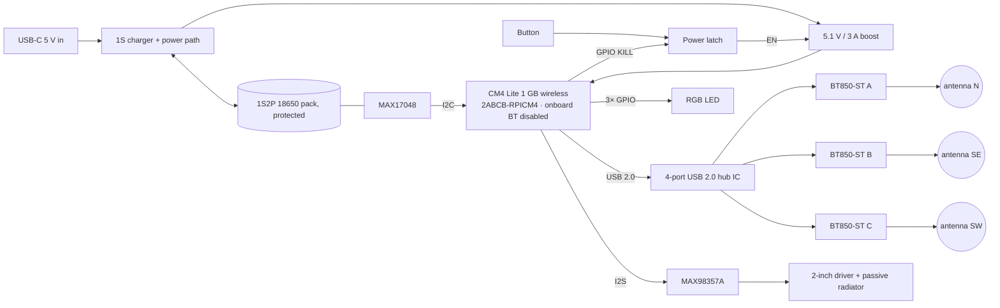

# Campfire hardware — Lightest Certifiable Campfire (decided 2026-10-21)

Branch `lightest-certifiable-campfire`. The step-by-step path to the first
shipped unit is `docs/first-speaker-manual.md`; the shopping list is
`hardware/bom/phase1-shopping-list.md`.

## Decisions

| Decision | Choice | Why |
|---|---|---|
| Phone → device | **AirPlay 2 over WiFi** | Sound segregation; the Bluetooth-in "sync-only" product is tabled |
| Compute, Phase 1 | **Raspberry Pi 4 Model B 1 GB** | 5 GHz + FCC Single Modular grant 2ABCB-RPI4B; same image; 4 USB ports |
| Compute, Phase 2 | **CM4 Lite 1 GB wireless** on our carrier | Same silicon, modular grant 2ABCB-RPICM4, eMMC option (no SD) |
| Bluetooth radios | **Ezurio BT851** (Phase 1, plug-in) → **BT850-ST** or **Fn-Link 6221E-UUC** (Phase 2, soldered) | All carry modular grants; generic `btusb` |
| Built-in, STANDARD/EXTENDED | **Go class**: MAX98357A 3 W, 2-inch driver, one passive radiator, sealed 0.4 L chamber, software EQ + limiter | ~$13 over a bare driver; matches the JBL Go in the rig |
| Built-in, LITE (later) | **Flip class**: TAS5805M 2×20 W with DSP, woofer + tweeter, two passive radiators, 3S cells | LITE is only the built-in |
| Power, Phase 1 | UPS board, 2 × 18650, I²C gauge → safe shutdown | ~6 h at party volume |
| Backend | none | Button = credential; long press = factory reset; firmware from a static file host |

Because every radio is modular, **a hand-built Phase 1 unit can be Part 15B
tested and sold.** Phase 2 is a cost-down.

## SKUs

| SKU | Radios | Built-in | Status |
|---|---|---|---|
| STANDARD | 1 | Go class | selling first |
| EXTENDED | 3 | Go class | selling first |
| LITE | 0 | Flip class | later |

## Phase 1 — Pi 4B unit (hand-built, certifiable)

- Wiring: `phase1/wiring-pi4b.svg` · pins: `phase1/pinout.md` · box:
  `phase1/enclosure-layout.svg`.
- Radios in the USB 2.0 ports first; the third on a 20 cm extension to a rear
  corner. Radios at N / SE / SW, away from the Pi's WiFi antenna.
- Two-bay enclosure: sealed acoustic chamber in front, vented electronics bay
  behind. 220 × 150 × 70 mm, 3 mm PETG.

Parts, you assemble, one-off prices with the UPS HAT: STANDARD ≈ $175,
EXTENDED ≈ $220 (`bom/phase1-shopping-list.md`). With a $14 charge board and a
home-printed box: $84–95 / $96–129.

## Phase 2 — CM4 carrier (cost-down)



| Block | Part | FCC | @100 | @1000 |
|---|---|---|---|---|
| Compute | CM4 Lite 1 GB wireless (CM4001000) + 2 × Hirose DF40C-100DS-0.4V + microSD (or eMMC variant, +$5) | 2ABCB-RPICM4 modular | $36.50 | $35 |
| Radios | Ezurio BT850-ST ($10.85) or Fn-Link 6221E-UUC ($4), × 1 or × 3 | SQGBT850 / 2AATL-6221EUUC modular | $4–33 | $3.50–30 |
| | USB 2.0 4-port hub IC (FE1.1s / USB2514B class) | — | $1.50 | $1 |
| | Antenna + pigtail per the module's grant, × radios | — | $1.30–4 | $1–2.50 |
| Audio | MAX98357A + 2-inch driver + passive radiator | — | $17 | $12 |
| Power | USB-C, 1S charger w/ power path (BQ2560x class), 5.1 V/3 A boost (TPS61088 class), MAX17048, pushbutton latch (LTC2954 class) | — | $8 | $5 |
| | 1S2P 18650 pack, protected, UN38.3 | — | $10 | $8 |
| UI | Button, RGB LED, passives | — | $1 | $0.50 |
| PCB | 4-layer ~100 × 80 mm, fab + assembly | — | $15 | $9 |
| Mech | Enclosure (print @100, molded @1000 + tooling) | — | $5 | $4 |
| **STANDARD** | | | **~$98–105** | **~$82–88** |
| **EXTENDED** | | | **~$110–131** | **~$92–110** |

### CM4 pin map

| Function | Pins | Notes |
|---|---|---|
| I²S to MAX98357A | GPIO18 BCLK · GPIO19 LRCLK · GPIO21 DOUT | `dtparam=i2s=on`, `dtoverlay=max98357a` |
| Fuel gauge | GPIO2 SDA1 · GPIO3 SCL1 | `dtparam=i2c_arm=on` |
| USB host → hub IC | USB_D+ / USB_D− | one USB 2.0 host on the module |
| Button | GPIO26, pull-up, also to the latch | |
| RGB LED | GPIO16 R · GPIO13 G (PWM1) · GPIO12 B (PWM0) | |
| Latch KILL | GPIO27 | asserted by a `poweroff` hook |
| Onboard BT | BT_nDisable → GND | the "built-in BT disabled" decision, in hardware |
| WiFi antenna | onboard PCB antenna, or the official antenna kit | stays inside the grant |
| Spare UARTs | UART2 GPIO0/1 · UART3 GPIO4/5 · UART4 GPIO8/9 | rev B UART-HCI radios |

### Power tree

```
USB-C 5 V ──► charger (power path) ──► 1S2P pack
                                          ├──► MAX17048 ──I²C──► CM4
                                          └──► boost 5.1 V / 3 A ──► CM4, hub, radios, amp
                                                    ▲ EN
                                                  latch ◄── button / CM4 KILL
```

## Certification path

- **Part 15B + SDoC** on the finished product, ~$4–10k, no radio testing.
  Co-location evaluation for the Pi WiFi + 1–3 BT modules (a calculation at
  these powers and 20 cm). Keep the amp's datasheet ferrite beads on the
  speaker leads.
- Labels: "Contains FCC ID: 2ABCB-RPI4B" (or 2ABCB-RPICM4) + one line per BT
  module (SQGBT850 or 2AATL-6221EUUC).
- Bluetooth SIG Declaration ID if the Bluetooth name/logo is used (~$2,500
  small-company rate; verify).
- Cells with UN38.3; pack-level IEC 62133-2 when a vendor pack is bought.

## Dongle vs module vs chip

| Option | Per radio | Certification you pay for |
|---|---|---|
| Consumer dongle (RTL8761B) | $5–8 | Not transferable to a product |
| **Pre-certified module, soldered or plugged** | $4–17 | Part 15B on your product only |
| Bare chip + crystal + antenna trace | $1.50–3 | Your own Part 15C test (~$10–20k) + Bluetooth SIG listing (~$10k); pays back past ~10k units |

## LITE — Flip-class design (later)

TAS5805M (I²S, on-chip DSP: ch1 woofer, ch2 tweeter, crossover in DSP),
3-inch woofer + tweeter, two passive radiators, 3 × 18650 in series (11.1 V to
the amp), 3S charger from USB-C, 5 V/3 A buck for the compute. ~$125 Phase 1
parts; ~$131 @100 on the carrier. Runtime 3–4 h at party volume.

## Files to produce next

1. Enclosure CAD (Tinkercad/Fusion) from `phase1/enclosure-layout.svg`.
2. KiCad schematic for the Phase 2 carrier from the block diagram and pin map
   (start from Raspberry Pi's CM4 IO Board design files).
3. BOM CSV with LCSC part numbers for assembly.
