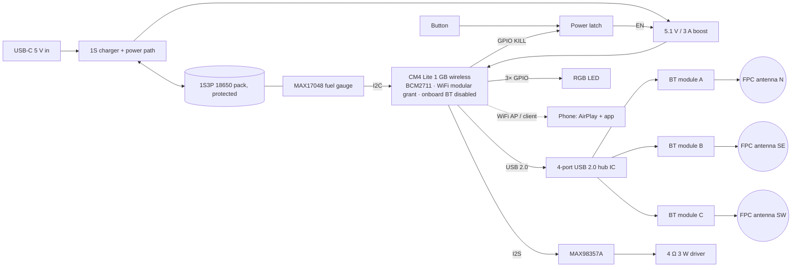

# Campfire Bridge — Finished-Product Hardware (rev A, 2026-10-17)

One PCB in one enclosure, standalone, battery-powered. Does what the Pi 5 dev
rig does: AirPlay 2 receiver over WiFi (home network or its own hotspot), audio
fanned out in sync to a built-in speaker and 1 (Limited) or 3 (Extended)
Bluetooth speakers. The software image is the one `bridge/setup-pi.sh` builds.
The SoC is the same BCM2711 as the Pi 4B, so nothing in `bridge/` changes except
device-tree lines in `config.txt`.

---

## What is inside a JBL, and why this board looks different

Open a JBL and you find: one Bluetooth *audio* SoC (radio + DSP + DAC in one
chip), a class-D amp, a charger IC, a Li-ion cell, and a copper antenna trace
on the PCB. No USB port except charging, no dongle. It is a single-radio A2DP
**sink** and never runs Linux.

Campfire is the opposite device: an AirPlay **receiver** (needs WiFi and a
Linux-class SoC for shairport-sync + nqptp) that is also three A2DP
**sources**. So the board is a compute module plus three radios instead of one
audio chip. But the radios go on the board the JBL way — a module or a chip
soldered down, with an antenna — not as dongles in ports.

---

## Block diagram



---

## Parts — Extended (Limited depopulates radios B and C)

"Class" means any equivalent part; pick the one JLCPCB/LCSC has in stock when
the schematic is drawn. Prices are 2026-10 estimates for one unit at that run
size; replace with quotes.

| Block | Part | Qty | @100 | @1000 | Notes |
|---|---|---|---|---|---|
| Compute | **Raspberry Pi CM4 Lite, 1 GB, wireless** (CM4001000) | 1 | $30 | $30 | Same silicon as the Pi 4B bench unit. WiFi carries an FCC modular grant. Pi does not discount much at volume. |
| | Hirose DF40C-100DS-0.4V receptacles | 2 | $2.5 | $2 | The CM4's two 100-pin connectors |
| | microSD 16 GB A1 + socket | 1 | $4 | $3 | Or CM4 with 8 GB eMMC (+$5) and drop the socket |
| Radios | **BT 5.x dual-mode module, USB HCI, class 1, FCC modular grant + Bluetooth QDID, u.FL** | 3 | $15 | $10.5 | Soldered down. BlueZ sees each as `hciX` exactly as the dongles do today. See "Dongle vs module vs chip" |
| | USB 2.0 4-port hub IC (FE1.1s / USB2514B class) + crystal | 1 | $1.5 | $1 | The CM4 exposes one USB 2.0 host |
| | 2.4 GHz FPC antenna + u.FL pigtail | 3 | $4 | $2.5 | Antennas at the enclosure corners (N / SE / SW); must match the module grant's antenna type and gain |
| Audio | **MAX98357A** I²S DAC + 3 W class-D | 1 | $2 | $1.5 | `dtoverlay=max98357a`, replaces the USB speaker |
| | 4 Ω 3 W full-range driver, 50–57 mm | 1 | $4 | $2.5 | |
| Power | USB-C receptacle + 5.1 kΩ CC pull-downs + ESD | 1 | $0.8 | $0.5 | 5 V only, no PD negotiation |
| | 1S Li-ion charger with power path, ≥2 A input (BQ2560x / BQ2589x class) | 1 | $1.5 | $1 | Charges while playing |
| | 5.1 V / 3 A boost (TPS61088 class) + inductor | 1 | $2.5 | $1.5 | Must hold 5.1 V through the ~1.3 A boot spike |
| | **MAX17048** fuel gauge | 1 | $1.5 | $1 | I²C. The safe-shutdown threshold comes from here, not from cell voltage |
| | Pushbutton power latch (LTC2954 class, or discrete) | 1 | $1.5 | $0.5 | Press → on. Pi runs `poweroff`, then asserts KILL → boost off → true zero draw |
| | **1S3P 18650 pack, protected, ~9–10 Ah / 32–36 Wh**, bought with UN38.3 + IEC 62133-2 reports | 1 | $18 | $14 | ~7–8 h at ~3.5 W average while playing. 2P ≈ 5 h, 4P ≈ 10 h. Under 100 Wh, so ships as ordinary cargo |
| UI | Tactile button, RGB LED, resistors | 1 | $0.5 | $0.3 | One button: short = camping toggle, long = power, 10 s = factory reset |
| PCB | 4-layer ~100 × 80 mm, fab + SMT assembly | 1 | $20 | $9 | JLCPCB / PCBWay assembly at 100; a contract line at 1000 |
| Mech | Enclosure | 1 | $20 | $4 | MJF print at 100; injection-molded at 1000 (+$5–15k tooling) |
| | Screws, foam, thermal pad, speaker gasket | — | $2 | $1 | |
| Box | Packaging, insert, labels | 1 | $4 | $2.5 | |
| Labour | Final assembly + functional test | — | $12 | $6 | |
| **Extended total, contract-assembled** | | | **~$148** | **~$95** | plus tooling at 1000 |
| **Limited total, contract-assembled** | −2 modules, −2 antennas | | **~$135** | **~$86** | |
| **Extended, parts only — you assemble**, FDM-printed or project box, no retail packaging | | | **~$110** | **~$80** | drops the labour, packaging and service-printed enclosure lines; the first 5 boards run ~$130–140 each because fab setup fees dominate |
| **Limited, parts only — you assemble** | | | **~$97** | **~$72** | |

The compute module is a third of the cost at 1000 units. The next product-level
cut is replacing the CM4 with an Allwinner H618-class core board (~$12) or an
own-design SoC section, which only pays off past ~5k units because it means a
6-layer board with DDR routing and a BSP port.

---

## Dongle vs module vs chip — the radio decision

A USB Bluetooth dongle is: one controller IC (RTL8761B, CSR8510 or similar), a
crystal, about six passives, a PCB antenna, and a USB-A plug. Three ways to put
that on the board:

| Option | Per radio | What you get | Certification you pay for |
|---|---|---|---|
| Consumer dongle in a port (today) | $5–8 | Works now | None of it transfers to a product: a dongle's FCC ID covers the dongle, not your box |
| **Pre-certified module, soldered down** | $3–6 | The dongle circuit already built, shielded, with an FCC modular grant and a Bluetooth QDID you reference | Part 15B on your product (~$4–10k total, not per radio) |
| Bare chip + crystal + passives + antenna trace | $1.5–3 | Cheapest per unit | Your own Part 15C intentional-radiator test (~$10–20k) and your own Bluetooth SIG listing (~$10k) |

**Answer: modules, soldered down.** They are the dongle's parts on your board,
they cost $2–4 less per radio than dongles and need no connectors or hub ports,
and they keep certification at the cheap end. Bare chips save another $2–3 per
radio but cost $20–30k more to certify, so they only pay back past ~10k units.

USB HCI vs UART HCI: USB-HCI modules go through the hub IC and look identical
to today's dongles to BlueZ. UART-HCI modules (CSR8811 / CYW20704 / RTL8761
H5 class, $2–5) skip the hub and use three of the BCM2711's UARTs, with one
`btattach` per radio in the image. Use USB HCI for rev A because it is
zero-risk for the software; UART is the rev B cut.

---

## Power tree

```
USB-C 5 V ──► charger (power path) ──► 1S3P pack (3.0–4.2 V)
                                          │
                                          ├──► MAX17048 ──I²C──► CM4
                                          │
                                          └──► boost 5.1 V / 3 A ──► CM4 5V, hub, BT modules, MAX98357A
                                                    ▲ EN
                                                  latch ◄── button / CM4 KILL GPIO
```

- Charge-while-playing is the charger's power path: input feeds the load and
  the cell; the boost always runs from the cell side.
- Safe shutdown: a small service reads the MAX17048 over I²C and runs
  `systemctl poweroff` below the threshold; after halt the CM4 drives KILL and
  the latch cuts the boost. No cell drain while off.
- `BT_nDisable` on the CM4 tied low: the onboard BT is off in hardware, which
  is the "built-in BT disabled" decision made permanent.
- Expected draw (Pi 4B class, estimate until E6 is re-run on the bench unit):
  ~2.5–3 W idle, ~3.5 W playing, ~5 W worst case (hotspot + 3 BT + amp at full).
  Boot spike ~1.3 A.

---

## CM4 pin map

| Function | CM4 / BCM2711 pins | Notes |
|---|---|---|
| I²S to MAX98357A | GPIO18 BCLK · GPIO19 LRCLK · GPIO21 DOUT | `dtparam=i2s=on`, `dtoverlay=max98357a` |
| Fuel gauge | GPIO2 SDA1 · GPIO3 SCL1 | `dtparam=i2c_arm=on` |
| USB host → hub IC | USB_D+ / USB_D− | one USB 2.0 host on the module |
| Button | GPIO26, pull-up, also to the latch | `gpio-shutdown` overlay or the camping daemon |
| RGB LED | GPIO16 · GPIO20 · GPIO25 + resistors | pulsing blue / white / orange / red states |
| Latch KILL | GPIO27 | asserted by a `poweroff` hook |
| Onboard BT | BT_nDisable → GND | |
| WiFi antenna | onboard PCB antenna | external u.FL needs the official antenna kit to stay inside the grant |
| microSD (CM4 Lite) | SD_CLK / SD_CMD / SD_DAT0–3 | |
| Spare UARTs (rev B UART-HCI radios) | UART2 GPIO0/1 · UART3 GPIO4/5 · UART4 GPIO8/9 | `dtoverlay=uart2` etc. |

---

## Enclosure

- Three FPC antennas at the corners (N / SE / SW), as far apart as the box
  allows, away from the CM4's WiFi antenna. Short pigtails; the PCB stays in
  the middle.
- Driver on the front face with a gasket; cell bay behind it; USB-C, button and
  LED on the back face.
- No fan. The CM4 gets a thermal pad to a metal plate or the enclosure wall.
- First 100 units: MJF nylon print or a stock ABS box with a CNC'd front.
  Molded at 1000.

---

## Files to produce next, in order

1. **Schematic** (KiCad). Start from Raspberry Pi's published CM4 IO Board
   design files for the module connectors, power and SD; add the hub, three
   module footprints, MAX98357A, charger/boost/gauge/latch, USB-C, button, LED.
2. **Layout**, 4-layer. RF keep-outs under the modules and antennas; the boost
   inductor away from the radios.
3. **Enclosure CAD** with the antenna positions fixed first.
4. **BOM CSV with LCSC part numbers** for assembly.
5. **Image changes**: the `config.txt` lines above, `btattach` only if UART
   radios, the fuel-gauge shutdown service.

These four files are also the plan package: the FCC lab wants 1, 2 and the
module FCC IDs; patent counsel wants the block diagram and 1.
